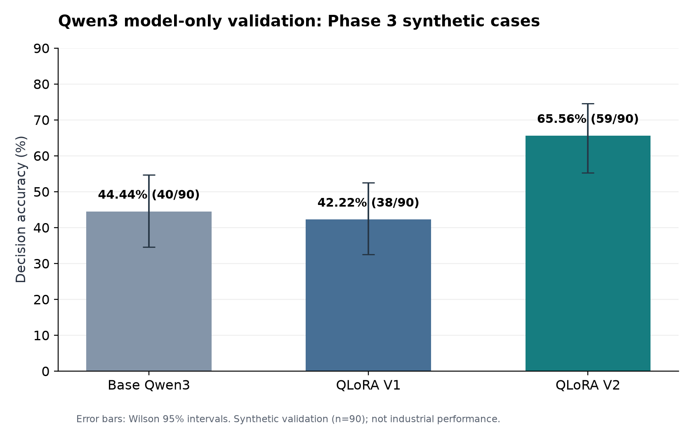

# Manufacturing Engineering Copilot

A local research prototype that combines a Qwen3-1.7B QLoRA experiment with
deterministic engineering calculations and source-cited document retrieval.

[](#verification)
[](#limitations-and-safety)

The project covers six bounded manufacturing workflows. Numerical outputs come
from deterministic Python functions, not model-generated arithmetic. Requests
with missing inputs or unavailable documents are rejected rather than filled in
with guesses. The fine-tuned adapters are optional and cannot override computed
inspection decisions.

> **Research-only, not for product release, autonomous machining, ISO compliance
> certification, equipment operation or worker-safety decisions.**

## Architecture

```text
Operator -> local browser or CLI
           |-- design fit/clearance checks (Decimal)
           |-- ideal turning process estimates
           |-- production OEE calculations
           |-- dimensional QA inclusive-limit checks (Decimal)
           |-- retrospective maintenance MTBF/MTTR
           |-- DRAFT inspection record generator
           |-- extractive RAG (approved-labelled .md/.txt, SHA-256 + line refs)
                  \-- optional Qwen3/LoRA ranking of already retrieved snippets
                       [not permitted to alter calculations or invent standards]
```

The project contains **one trained QA SLM experiment**, not six independently
trained domain-specific models. Phase 4's `demo` documents are intentionally
fictional; real approved materials are not shipped.

## Quick start

Python 3.12 is recommended. The CPU-only workbench uses the standard library and
does not require CUDA, model weights or Unsloth.

```powershell
py -3.12 -m venv .venv
.\.venv\Scripts\python.exe -m unittest discover -s tests -v
.\.venv\Scripts\python.exe -m phase5.web_app
```

Open **http://127.0.0.1:8765/**. The server binds only to loopback and refuses
untrusted `Host` headers. It is a single-user demonstration, not a public
application. To use the offline CLI:

```powershell
.\.venv\Scripts\python.exe -m phase5.cli
```

For **numerical QA**, try:

```text
quality nominal=20.00 measured=20.03 tolerance=0.05 unit=mm
quality nominal=20.00 measured=20.09 tolerance=0.05 unit=mm
```

Expected results for that single dimension: `PASS` and `FAIL`. For model
training and evaluation, see the phase-specific guides listed under
[Project documentation](#project-documentation).

## Six supported engineering slices

| Domain | Implemented calculation or workflow | Not claimed |
|---|---|---|
| Design | One-dimensional worst-case fit classification | Full CAD / ISO fit tables / FEA |
| Process planning | Ideal single-pass turning RPM, feed, cutting time | Machine-ready NC parameters |
| Production | Availability, performance, quality, OEE | Automated MES optimization |
| Quality | Inclusive bilateral/asymmetric dimensional tolerances | Part or batch release |
| Maintenance | Historical MTBF, MTTR, observed availability | Predictive RUL or automated maintenance |
| Documentation | Traceable inspection-record draft | Legally approved or digitally signed record |

Phase 4 retrieves exact approved-labelled `.md` and `.txt` paragraphs,
with SHA-256 integrity checks and line citations. Human approval metadata
is provided by the operator, not cryptographically authenticated.

## Model-training methodology

- **Foundation:** `unsloth/Qwen3-1.7B-unsloth-bnb-4bit`.
- **Hardware used by operator:** NVIDIA RTX 4060 Laptop GPU, 8 GB VRAM.
- **Fine-tuning:** 4-bit QLoRA, rank 8, alpha 16, supervised fine-tuning.
- **Phase 1 dataset:** 72 train / 18 validation / 24 test synthetic cases.
- **Phase 3 V2 dataset:** 480 train / 90 validation / 120 held-out synthetic cases.
- **Phase 3 V2 configuration:** 120 steps, batch 1, gradient accumulation 4,
  learning rate 1.2e-4. V2 trains independently from the foundation model.
- **Checkpoints:** created on the operator's laptop, not bundled or committed.

Run model training locally if necessary (`.venv` must have GPU PyTorch + Unsloth):

```powershell
.\.venv\Scripts\python.exe -m phase3.validate_data
.\.venv\Scripts\python.exe -m phase3.train_v2 --smoke
.\.venv\Scripts\python.exe -m phase3.train_v2
```

The V2 training script refuses to overwrite an existing adapter. If you have
already trained V2, **do not run it again**. Your existing local model remains
outside the source release.

## Observed synthetic-validation outcomes

Same Phase 3 synthetic validation split, `n = 90`:

| Model | Correct | Accuracy | False PASS | False FAIL |
|---|---:|---:|---:|---:|
| Base Qwen3 | 40/90 | 44.44% | 8 | 11 |
| QLoRA V1 | 38/90 | 42.22% | 6 | 3 |
| QLoRA V2 | 59/90 | **65.56%** | **1** | 24 |

*Source: console comparison supplied by the operator (2026-11-13); local
model-result JSON is not included in GitHub. These are synthetic validation
results, not industrial accuracy.* V2 improves accuracy on this sample but
exhibits 24 false rejections. We therefore **do not** delegate numerical
inspection decisions to the standalone SLM.

Generated figures:




Regenerate with:

```powershell
.\.venv\Scripts\python.exe -m pip install -r requirements-phase6.txt
.\.venv\Scripts\python.exe -m phase6.plot_results
```

The script uses local `results/phase3/*.json` when all corresponding actual
model-evaluation artifacts exist, checks dataset hashes and split identity, and
uses labelled operator-reported scores only as a fallback. It also generates a
V2 training-loss figure if the original V2 trainer-state log exists locally.
See [`docs/PAPER_FIGURE_NOTES.md`](docs/PAPER_FIGURE_NOTES.md) for captions and
limits. Phase 1 small-data metrics are deliberately excluded from the Phase 3
side-by-side chart because the data distributions differ.

## Verification

```powershell
.\.venv\Scripts\python.exe -m phase6.reproduce
.\.venv\Scripts\python.exe -m phase6.release_checks
```

The CPU suite includes all unit tests, Phase 3 data provenance and split hashes,
Phase 4 fictional retrieval regressions, Phase 5 arithmetic checks and an
expanded **529-case** tolerance-boundary grid. GitHub Actions runs CPU checks
without downloading model weights or installing GPU packages. These tests
establish **software behavior under included cases**, not shop-floor fitness.

## Project map

```text
src/             Phase 1 QLoRA and Phase 2 deterministic + hybrid QA
phase3/          Expanded synthetic QA dataset, V2 training, model comparison
phase4/          Hash-verified, line-cited extractive RAG
phase5/          Six-domain calculators, local CLI and browser dashboard
phase6/          Reproducibility checks, audit, metric import and paper figures
tests/           CPU-only regression suites
paper_figures/   Observed synthetic metrics and loss charts (PNG/SVG + source CSV)
configs/         Training configurations
models/          Local adapters and checkpoints (gitignored)
results/         Operator-local benchmarks and predictions (gitignored)
```

## Limitations and safety

- No real manufacturing field evaluation or independent engineer-reviewed data
  has been supplied for this repository release.
- No autonomous tool operation, motion control, product release or compliance
  decision is implemented.
- Calculations require correctly entered units and valid measurements;
  source calibration, uncertainty budgets and other acceptance criteria are
  outside scope.
- RAG's default published documents are fictional examples. Third-party
  standards and confidential work instructions are not redistributed.
- Local HTTP UI has no user authentication, database, tamper-proof audit log,
  or multiuser security controls. Do not expose to the internet.
- AI training and paper drafting must be disclosed as required by the venue.
  See `MODEL_CARD.md` and `docs/PAPER_FIGURE_NOTES.md` before citing metrics.

## Project documentation

- [Phase 3: expanded dataset and V2 training](PHASE3_README.md)
- [Phase 4: local grounded retrieval](PHASE4_README.md)
- [Phase 5: six-domain workbench](PHASE5_README.md)
- [Phase 6: reproducibility and figures](PHASE6_README.md)
- [Model card](MODEL_CARD.md)
- [Release notes](RELEASE_NOTES.md)

## Repository contents and reuse

Code is released under the MIT License (see `LICENSE`). Model weights and
individual foundation-model licensing remain governed by their own terms. No
private documents, adapters, or evaluation prediction logs are in the source
archive. Configuration and dataset generation are included for reproducibility.
