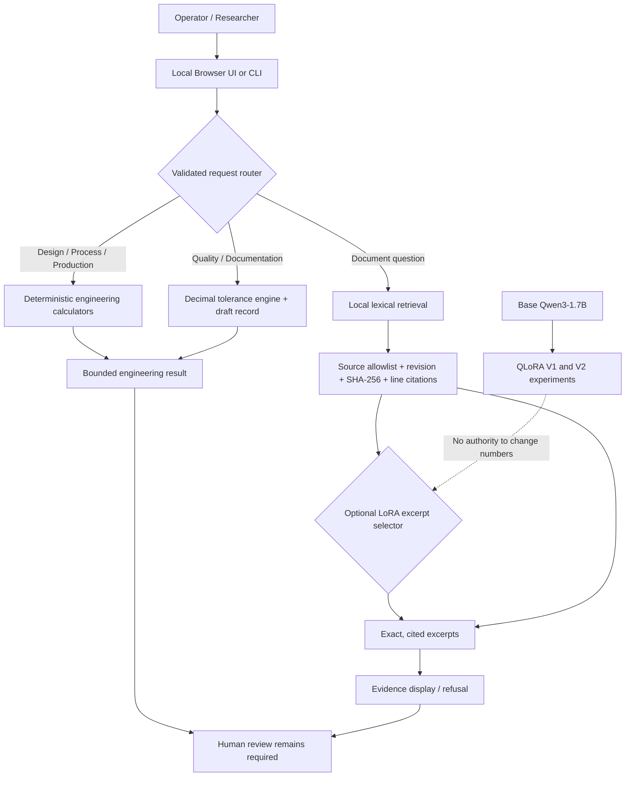

<div align="center">

# 🏭 MANUFACTURING ENGINEERING COPILOT

### A small language model. A verifiable engineering toolkit. One unified manufacturing workbench.

**Qwen3-1.7B · 4-bit QLoRA · Deterministic Engineering · Grounded RAG · Six Manufacturing Domains**

<br>


**[Overview](#-project-overview) · [Architecture](#-system-architecture) · [Six Domains](#-six-domain-engineering-workbench) · [Training](#-slm-training--experimental-design) · [Results](#-experimental-results) · [Run Locally](#-getting-started) · [Limitations](#-limitations--responsible-use)**

</div>

---

> [!IMPORTANT]
> **Research and educational software, not an autonomous industrial control system.** It does not authorize product release, establish ISO/ASME compliance, operate machinery, or replace qualified engineering review. All reported model accuracy values are from **synthetic data**.

## ✨ At a glance

| Research artifact | Implemented outcome |
|:--|:--|
| **Foundation model** | Qwen3-1.7B, 4-bit quantized |
| **Fine-tuning** | Two local QLoRA experiments, V1 and independently trained V2 |
| **Core engineering approach** | Verified Python calculations separated from neural generation |
| **Engineering coverage** | Design, process planning, production, quality, maintenance, and documentation |
| **Knowledge system** | Local extractive retrieval with line citations, revisions and SHA-256 |
| **Application** | Localhost browser workbench and terminal interface |
| **Model comparison** | Base vs V1 vs V2 on the same 90-example synthetic validation split |
| **Publication assets** | Accuracy comparison, error-mode counts and observed V1 loss graph |
| **Release verification** | 111/111 CPU unit tests; separate retrieval, regression and boundary suites |

### The central idea

**A language model can be useful in engineering without being trusted to invent engineering facts.**

Manufacturing work combines calculations, controlled documents, traceability, input validation and human responsibility. This project studies a *hybrid* architecture: a fine-tuned small language model provides a limited AI component, while deterministic code performs numerical checks, a provenance-aware document system supplies source excerpts, and an operator remains responsible for review.

The goal is not to make a 1.7B-parameter model sound confident. The goal is to make every supported result **inspectable, reproducible and bounded**.

---

## 📚 Table of contents

1. [Project overview](#-project-overview)
2. [Problem statement and research objectives](#-problem-statement--research-objectives)
3. [System architecture](#-system-architecture)
4. [Six-domain engineering workbench](#-six-domain-engineering-workbench)
5. [Development journey: Phases 1–6](#-development-journey-phases-16)
6. [SLM training and experimental design](#-slm-training--experimental-design)
7. [Experimental results](#-experimental-results)
8. [Grounded RAG and document provenance](#-grounded-rag--document-provenance)
9. [Getting started](#-getting-started)
10. [Verification and reproducibility](#-verification--reproducibility)
11. [Repository structure](#-repository-structure)
12. [Limitations and responsible use](#-limitations--responsible-use)
13. [Future research and acknowledgements](#-future-research--acknowledgements)

---

## 🎯 Project overview

**Manufacturing Engineering Copilot** is a modular Python research prototype that brings together:

- **SLM adaptation:** fine-tuning a quantized Qwen3-1.7B foundation model on structured synthetic quality-inspection examples.
- **Verified numerical reasoning:** separate arithmetic functions implemented in Python, including `Decimal` for tolerance decisions.
- **Grounded document access:** verbatim excerpts from registered local documents, tied to source identifiers, revisions, line references and content hashes.
- **Six engineering workflows:** explicitly defined tasks with field validation and clear limits.
- **Accessible interaction:** a local web application and a CLI, without requiring a GPU for deterministic tools.
- **Reproducibility:** dataset integrity checks, regression suites, an evaluation script, provenance-aware figure generation and a CPU CI workflow in the prepared source package.

### Why a hybrid system?

A standalone language model can produce fluent text and still mishandle a simple tolerance decision. One observed failure involved a nominal size of **20.00 mm**, a tolerance of **±0.05 mm**, and a measured size of **20.03 mm**. The correct single-dimension result is **PASS**, yet standalone model behavior was not consistently reliable.

This motivated a deliberate division of responsibility:

| Task | Responsible component | Can the SLM override it? |
|:--|:--|:--:|
| Numerical dimensional inspection | `src.tolerance_engine` | **No** |
| Fit, turning, OEE, maintenance indicators | `phase5.calculators` | **No** |
| Missing/invalid input refusal | Validated Python workflow | **No** |
| Retrieving document evidence | `phase4.retrieval` | **No** |
| Selecting one of the retrieved excerpts | Optional Qwen/LoRA selector | **Selection only** |
| Product/lot approval | Authorized human workflow, outside prototype | **No** |

---

## 🧩 Problem statement & research objectives

### Problem statement

Manufacturing questions frequently depend on *exact numbers*, *current drawing revisions*, *inspection identifiers*, *approved procedures* and *equipment context*. Small generative models may hallucinate standards requirements, misinterpret tolerance boundaries or answer when inputs are incomplete. Purely rule-based systems, meanwhile, are less flexible in how users ask questions and explore supporting documents.

### Research objectives

1. Investigate 4-bit QLoRA adaptation of a compact language model for structured dimensional-inspection tasks.
2. Evaluate **base**, **V1** and **V2** models using an identical synthetic validation split and report their error modes, not accuracy alone.
3. Prevent the neural model from altering deterministic numerical inspection outcomes.
4. Build transparent document retrieval that exposes exact evidence rather than fabricated standards citations.
5. Integrate six bounded manufacturing workflows in a unified user interface.
6. Preserve dataset, configuration and source provenance to support repeatable software experiments and later peer review.

**Scope discipline:** these objectives describe a research prototype. They do **not** imply completion of real-plant trials or certification-level engineering validation.

---

## 🏗️ System architecture



### Engineering principles

| Principle | Implementation |
|:--|:--|
| **Tool-first numerical answers** | Calculations execute in Python, independent of model logits |
| **Fail closed** | Missing, ambiguous, nonsensical or unsupported values produce refusal |
| **Evidence before claims** | Document responses expose retrieved text rather than free-form standards assertions |
| **Traceability** | Revision metadata, source lines and SHA-256 checksums accompany excerpts |
| **Separation of duties** | Model output cannot authorize an inspection decision or record approval |
| **Human in the loop** | Records remain drafts; product release is not implemented |
| **Research honesty** | Synthetic model metrics and software regression results are reported separately |

---

## 🛠️ Six-domain engineering workbench

The workbench covers **six targeted task slices**, not the entirety of each industrial discipline. Each domain uses structured inputs, deterministic processing where applicable and conservative validation.

<details open>
<summary><strong>01 · Design engineering | Hole–shaft fit analysis</strong></summary>

<br>

**Implemented:** one-dimensional worst-case clearance calculations for a hole and shaft.

**Required inputs:** `hole_min`, `hole_max`, `shaft_min`, `shaft_max`. Optional unit: `mm`.

```text
Minimum clearance = Minimum hole size − Maximum shaft size
Maximum clearance = Maximum hole size − Minimum shaft size
```

**Classification logic:**

- Minimum clearance greater than zero → **CLEARANCE**
- Maximum clearance less than zero → **INTERFERENCE**
- Otherwise → **TRANSITION**, including contact at zero clearance

**Example command**

```text
design hole_min=20.00 hole_max=20.04 shaft_min=19.97 shaft_max=20.01 unit=mm
```

This produces a worst-case clearance range of **−0.01 to +0.07 mm**, hence **TRANSITION**.

**Out of scope:** geometric tolerancing, complete tolerance chains, finite-element analysis, automated CAD modeling and certified ISO fit tables.

</details>

<details>
<summary><strong>02 · Process planning | Ideal turning-time calculation</strong></summary>

<br>

**Implemented:** idealized spindle speed, linear feed rate and cutting-time arithmetic for a single turning pass.

```text
RPM             = (1000 × cutting speed in m/min) / (π × diameter in mm)
Feed (mm/min)   = RPM × feed per revolution (mm/rev)
Cutting time    = Cutting length (mm) / feed (mm/min)
```

**Example command**

```text
process diameter_mm=20 cutting_speed_m_per_min=100 feed_mm_per_rev=0.2 length_mm=80
```

**Interpretation:** mathematical planning estimate only. It excludes tool wear, approach and retract distance, cutting conditions, machine constraints, safety factors, part material and real-time machining dynamics.

**Never treat these computed values as validated machine-control instructions.**

</details>

<details>
<summary><strong>03 · Production engineering | Overall Equipment Effectiveness</strong></summary>

<br>

**Implemented:** OEE from supplied production totals.

```text
Availability = Run time / Planned production time
Performance  = (Ideal cycle time × Total units) / Run time
Quality      = Good units / Total units

OEE = Availability × Performance × Quality
```

**Example command**

```text
production planned_min=480 run_min=420 ideal_cycle_min_per_part=1 total_parts=350 good_parts=335
```

The tool validates contradictory values, including **good parts greater than total parts**, **run time greater than planned time**, or a computed performance ratio greater than one.

**Out of scope:** live manufacturing execution systems, plant scheduling, bottleneck optimization, automatic machine telemetry and production forecasting.

</details>

<details>
<summary><strong>04 · Quality assurance | Verified dimensional inspection</strong></summary>

<br>

The original engineering safety-critical slice. It evaluates a **single scalar dimension** against user-provided inclusive limits using Python `Decimal`.

For a symmetric tolerance:

```text
Lower specification limit = Nominal − Tolerance
Upper specification limit = Nominal + Tolerance

PASS ⇔ Lower limit ≤ Measurement ≤ Upper limit
```

For asymmetric tolerances, both `lower_dev` and `upper_dev` are supported. The tool rejects incomplete or conflicting tolerance specifications instead of guessing.

**Example A: conforming dimension**

```text
quality nominal=20.00 measured=20.03 tolerance=0.05 unit=mm

Decision: PASS
Lower limit: 19.95 mm
Upper limit: 20.05 mm
Measured: 20.03 mm
```

**Example B: nonconforming dimension**

```text
quality nominal=20.00 measured=20.09 tolerance=0.05 unit=mm

Decision: FAIL
Measured: 20.09 mm > Upper limit: 20.05 mm
```

**What PASS means:** the supplied measurement falls inside the supplied interval. It does **not** certify equipment calibration, measurement uncertainty, complete drawing conformity, material compliance or final product release.

</details>

<details>
<summary><strong>05 · Maintenance engineering | Historical reliability indicators</strong></summary>

<br>

**Implemented:** retrospective MTBF, MTTR and observed equipment availability from supplied operating and repair totals.

```text
Observed MTBF       = Operating hours / Number of failures
Observed MTTR       = Repair hours / Number of failures
Observed availability = Operating hours / (Operating hours + Repair hours)
```

**Example command**

```text
maintenance operating_hours=800 repair_hours=20 failures=4
```

These values are *historical indicators*, not a prediction of remaining useful life. For zero observed failures, **MTBF and MTTR are undefined** rather than fabricated as infinity.

**Out of scope:** predictive remaining useful life, vibration-based diagnosis, condition-monitoring sensors, maintenance work-order execution and safety-critical repair instructions.

</details>

<details>
<summary><strong>06 · Technical documentation | Traceable inspection record drafts</strong></summary>

<br>

**Implemented:** structured inspection-record drafting with mandatory identifiers and an independently computed dimensional result.

**Required fields:** record ID, feature ID, drawing ID, revision, nominal, measured value, tolerance, unit, equipment ID and a timezone-aware ISO-8601 timestamp. Optional operator identifier.

**Example command**

```text
documentation record_id=IR-001 feature_id=SHAFT-1 drawing_id=DR-001 revision=A nominal=20 measured=20.03 tolerance=0.05 unit=mm equipment_id=GAUGE-7 timestamp=2026-11-13T09:30:00+05:30
```

Every record is marked:

```text
DRAFT_NOT_APPROVED
HUMAN_REVIEW_REQUIRED
```

Even when the dimensional result is **PASS**, the draft cannot become an approved production or inspection record by model decision.

**Out of scope:** electronic signatures, immutable audit trails, gauge calibration certification, controlled-document workflows and automated product disposition.

</details>

### Cross-domain document knowledge

The seventh route, `knowledge`, is a **retrieval service**, not a seventh engineering calculator. It finds exact excerpts in registered text/Markdown files and either cites them or abstains. Its safeguards are documented [below](#-grounded-rag--document-provenance).

---

## 🗺️ Development journey: Phases 1–6

| Phase | Major work | Research/engineering outcome |
|:--:|:--|:--|
| **01** | Qwen3 foundation, synthetic QA data, first QLoRA adapter | Established an end-to-end local training and evaluation pipeline |
| **02** | Decimal tolerance engine and strict input parsing | Moved numerical inspection decisions out of uncontrolled text generation |
| **02B** | Hybrid adapter-driven chat with verified calculations | Limited the model to permitted report-style selection while Python owned the result |
| **03** | Enlarged, hash-checked synthetic data; independent V2 training; model comparison | Enabled base/V1/V2 evaluation on the same split and exposed false rejection risk |
| **04** | Local provenance-aware extractive RAG | Added revisioned, SHA-256-checked, line-cited document evidence and abstention |
| **05** | Six-domain calculators, CLI and local dashboard | Unified validated workflows across design, process, production, QA, maintenance and records |
| **06** | Release tests, boundary stress grid, localhost HTTP hardening, research figures | Added a reproducibility harness and clearly sourced publication artifacts |

### The architectural turning point

Phase 3 showed that higher synthetic model accuracy did **not** automatically imply safe autonomous inspection. V2 reduced false acceptances but produced many false rejections. Rather than conceal that tradeoff, the later phases **moved trust to a verifiable tool boundary**.

---

## 🧠 SLM training & experimental design

### Foundation model and hardware

| Item | Setup |
|:--|:--|
| Foundation | `unsloth/Qwen3-1.7B-unsloth-bnb-4bit` |
| Architecture role | Compact decoder LLM used for limited QA adaptation and optional citation selection |
| Quantization | 4-bit base model |
| Fine-tuning method | QLoRA supervised fine-tuning |
| LoRA rank / alpha | `r=8` / `alpha=16` |
| Local training machine | Windows 11 laptop, NVIDIA RTX 4060 Laptop GPU with 8 GB VRAM |
| Python workflow | PyCharm, local virtual environment; project recommends Python 3.12 |
| Primary task | Structured dimensional-inspection labels and responses |
| Synthetic labels | `PASS`, `FAIL`, `INSUFFICIENT_DATA` |

### Configuration comparison

| Hyperparameter | V1 pilot | V2 experiment |
|:--|--:|--:|
| Training examples | 72 | 480 |
| Validation examples | 18 | 90 |
| Held-out test examples | 24 | 120 |
| Configured optimizer steps | 24 | 120 |
| Batch size | 1 | 1 |
| Gradient accumulation | 4 | 4 |
| Learning rate | 2.0 × 10⁻⁴ | 1.2 × 10⁻⁴ |
| Max sequence length | 512 | 512 |
| Seed | 3407 | 3407 |
| LoRA rank | 8 | 8 |
| LoRA alpha | 16 | 16 |

**Important:** V2 was configured to train **independently from the base foundation**, not by continuing V1. Both are distinct adaptation experiments.

### Dataset construction and checks

The datasets are **rule-generated synthetic scenarios**, not shop-floor measurements.

**Phase 1**
- 72 training cases
- 18 validation cases
- 24 held-out test cases

**Phase 3**
- 480 training cases
- 90 validation cases
- 120 held-out test cases
- 36 separate hand-authored regression/challenge cases, with 12 each of `PASS`, `FAIL` and `INSUFFICIENT_DATA`

The Phase 3 pipeline includes schema checks, dataset and split integrity, duplicate checks, label validation, dataset SHA-256 recording and result-file verification. The 36 challenge cases are author-created software tests, **not independently reviewed industrial ground truth**.

### Reproducibility commands

```powershell
# Dataset and split integrity, no GPU required
.\.venv\Scripts\python.exe -m phase3.validate_data

# GPU: baseline evaluation on the 90-case Phase 3 validation set
.\.venv\Scripts\python.exe -m phase3.evaluate_model --split validation --tag base

# GPU: evaluate an existing V1 adapter
.\.venv\Scripts\python.exe -m phase3.evaluate_model --split validation --adapter models/qa_qlora/adapter --tag v1

# GPU: evaluate an existing V2 adapter
.\.venv\Scripts\python.exe -m phase3.evaluate_model --split validation --adapter models/qa_qlora_v2/adapter --tag v2

# Compare only compatible dataset hashes and splits
.\.venv\Scripts\python.exe -m phase3.compare --split validation
```

> [!CAUTION]
> **Do not rerun training just to launch the application.** Existing local adapters are deliberately protected from overwriting. GPU checkpoints are excluded from the source release and should be managed separately.

---

## 📊 Experimental results

### A. Standalone model-only validation

**Evaluation population:** 90 synthetic Phase 3 validation cases per model, using the same dataset fingerprint.

| Model | Correct / 90 | Accuracy | False PASS | False FAIL |
|:--|--:|--:|--:|--:|
| Base Qwen3-1.7B | 40 / 90 | **44.44%** | 8 | 11 |
| QLoRA V1 | 38 / 90 | **42.22%** | 6 | 3 |
| **QLoRA V2** | **59 / 90** | **65.56%** | **1** | **24** |

**Observed synthetic validation accuracy**

```text
Base Qwen3   ██████████████████████                 44.44%
QLoRA V1     █████████████████████                  42.22%
QLoRA V2     █████████████████████████████████      65.56%
```

**Key observations**

- On this particular synthetic validation set, V2 correctly labeled **59/90** examples, compared with **40/90** for the base model and **38/90** for V1.
- V2 produced only **one false PASS** in the recorded comparison, but **24 false FAILs**. Its increased rejection tendency matters when assessing whether a standalone model should control quality decisions.
- V1's Phase 1 validation/test scores cannot be compared directly with Phase 3 scores because those datasets and templates differ.
- These results are **operator-reported local console measurements** recorded in `phase6/evidence/observed_comparison.json`, not an independently rerun GPU benchmark in the packaging environment.
- The separate Wilson 95% binomial intervals used in the figure generator do **not** prove statistical significance of a paired model improvement. Example-level paired predictions are required for a rigorous significance analysis.

**Validation set SHA-256**

```text
593151a2bff088f15507f3aa839bc276fa13cb8b53c92e05df3852952933c7ea
```

> [!NOTE]
> **False PASS** means an actually nonconforming synthetic case predicted as PASS; **false FAIL** means a conforming case predicted as FAIL. Those two counts do not include every possible misclassification category.

### B. Training-loss evidence

The V1 experiment has **24 observed optimizer-step loss points** and three evaluation-loss observations transcribed from the provided Unsloth training log. A training-loss curve is included in the prepared paper-figure assets.

Loss describes model fitting behavior, **not** shop-floor correctness or safe engineering authorization.

The **V2 training-loss curve is deliberately not fabricated**. Figure generation looks for actual V2 `trainer_state.json` logs on the operator's machine and creates that plot only if recorded data exists.

### C. Deterministic software verification

| Validation activity | Reported local result | What it establishes |
|:--|--:|:--|
| Full CPU unit-test suite | **111 / 111** | Included functional and security regression cases passed |
| Phase 4 fictional-document retrieval checks | **16 / 16** | Retrieval, citation/refusal behavior on the included toy corpus |
| Phase 5 six-domain tool checks | **30 / 30** | Expected behavior on hand-authored calculator/validation cases |
| Phase 6 tolerance-boundary grid | **529 / 529** | Arithmetic consistency at included numerical boundaries |

The release harness also checks dataset provenance, refusal paths, local HTTP behavior and source release exclusions.

**These totals are developer regression outcomes, not percentages of real-world manufacturing accuracy.** GPU validation and CPU tool regression evaluate *different things*.

### D. Paper-ready figure inventory

| Figure | Asset in prepared local source package | Scientific purpose |
|:--|:--|:--|
| **Fig. 01** | `paper_figures/Fig01_model_validation_accuracy.png` / `.svg` | Base/V1/V2 accuracy with Wilson binomial intervals |
| **Fig. 02** | `paper_figures/Fig02_false_acceptance_and_rejection.png` / `.svg` | Compares false acceptance and false rejection counts |
| **Fig. 03** | `paper_figures/Fig03_v1_training_loss.png` / `.svg` | Shows observed V1 optimization and evaluation loss |
| **Fig. 04 (conditional)** | `paper_figures/Fig04_v2_training_loss.*` | Generated only when genuine V2 trainer history is available |

Graph source metrics, figure provenance and scientifically qualified captions are defined in the prepared `docs/PAPER_FIGURE_NOTES.md`.

---

## 📖 Grounded RAG & document provenance

### How retrieval works

1. An operator registers a permission-cleared `.md` or `.txt` document.
2. A manifest records its identifier, revision, review status, file path and expected SHA-256.
3. The application verifies the registered file's content integrity before using it.
4. A transparent, BM25-like **lexical** retriever ranks paragraph-sized excerpts.
5. The response includes **exact source text**, citation IDs, line numbers and metadata.
6. Optionally, Qwen/LoRA may select **one existing retrieved excerpt**. It cannot fabricate new technical claims.
7. If no source passes the checks, the system **abstains**.

### Example: cited traceability guidance

A fictional demonstration snippet may be labeled:

```text
DEMO-TRACE-001:L5-L5
Revision: DEMO-1
Status: demo
Source: phase4/docs/demo_traceability.md
Integrity: SHA-256 checked
```

This tells the operator *where text came from*. It **does not** prove the document is an approved plant procedure.

### What happens without evidence?

```text
Question: What does ISO 9001:2015 require for product release?

NO VERIFIED DOCUMENT ANSWER.
No relevant registered source passed the provenance checks.
```

This refusal is **intentional**. The repository does not redistribute ISO, ASME or ASTM standards, and it must not invent clauses.

### Document trust model

| Source status | Default behavior |
|:--|:--|
| `demo` | Excluded unless `--include-demo` is specified |
| `draft` | Not used to answer document questions |
| `approved` | Eligible for retrieval with operator-declared review metadata |
| Altered/missing file | Integrity failure or refusal |

**Caveat:** the system cannot independently authenticate a reviewer's identity or the truth of a document's contents. A SHA-256 match demonstrates consistency with a registered file, not scientific or regulatory correctness.

**Example commands**

```powershell
# Inspect only fictional example documents
.\.venv\Scripts\python.exe -m phase4.rag_chat --include-demo

# Run with your existing V2 adapter as a guarded excerpt selector
.\.venv\Scripts\python.exe -m phase4.rag_chat --include-demo --adapter models/qa_qlora_v2/adapter

# Default: only operator-approved labelled documents, no fictional demo sources
.\.venv\Scripts\python.exe -m phase4.rag_chat
```

---

## 🚀 Getting started

### Requirements

- Windows 11 + Python 3.12 recommended
- PyCharm or an equivalent terminal environment
- GPU/Unsloth stack only for SLM training or optional adapter inference
- No CUDA, inference server or external API needed for the **CPU-only six-domain workbench**

> [!IMPORTANT]
> **Current GitHub publication status:** this README documents the verified local Phase 1–6 project and the prepared source-release archive. If the repository currently contains only this README, cloning it **will not yet install the app**. Use the existing local project until the complete source tree has been pushed. This note prevents incomplete repository checkouts from being mistaken for working releases.

### Start the existing local project

Run these commands in PowerShell from:

```text
C:\Users\Prajwal\Desktop\python\manufacturing-copilot
```

```powershell
# Full local CPU regression suite
.\.venv\Scripts\python.exe -m unittest discover -s tests -v

# Launch the local browser workbench
.\.venv\Scripts\python.exe -m phase5.web_app
```

Now open **http://127.0.0.1:8765/**.

To start with **fictional demo excerpts enabled**:

```powershell
.\.venv\Scripts\python.exe -m phase5.web_app --include-demo
```

To use the terminal interface:

```powershell
.\.venv\Scripts\python.exe -m phase5.cli
```

Inside the CLI, use `examples` to see command examples for the domains. To enable the optional trained V2 evidence selector:

```powershell
.\.venv\Scripts\python.exe -m phase5.cli --include-demo --adapter models/qa_qlora_v2/adapter
```

**Interface boundary:** the browser UI performs deterministic workflows and local retrieval. It is **not** a general-purpose autonomous Qwen chatbot.

### A short end-to-end demonstration

```text
1. Enter a dimensional case.
   nominal=20.00 measured=20.03 tolerance=0.05 unit=mm

2. Verify the computation.
   PASS, inclusive limits: 19.95–20.05 mm

3. Ask for a supporting document excerpt.
   knowledge What identifiers belong in an inspection record for traceability?

4. Inspect the document status and line-level citations.

5. Generate a structured inspection-record draft.

6. Send the draft for qualified human review.
   No software-generated product release is issued.
```

---

## ✅ Verification & reproducibility

**Recommended local verification**

```powershell
# Entire Phase 1–6 CPU suite and repeatability audit
.\.venv\Scripts\python.exe -m phase6.reproduce

# Source release policy and exclusion checks
.\.venv\Scripts\python.exe -m phase6.release_checks

# Domain-specific and retrieval regression suites
.\.venv\Scripts\python.exe -m phase5.benchmark
.\.venv\Scripts\python.exe -m phase4.benchmark

# Regenerate publication figures from actual available artifacts
.\.venv\Scripts\python.exe -m pip install -r requirements-phase6.txt
.\.venv\Scripts\python.exe -m phase6.plot_results
```

**Evaluation distinctions**

- **Model-only validation:** how the three standalone neural systems label the synthetic Phase 3 cases.
- **Hybrid QA verification:** whether Python gives the expected dimensional result and refuses invalid inputs.
- **RAG regression:** whether source excerpts, integrity checks, citations and abstentions work on fictional test documents.
- **Six-domain checks:** whether the supported calculators and record-generation constraints behave correctly.
- **HTTP checks:** whether the localhost interface enforces its intended host, origin, content and request bounds.

Different tests answer different research questions. Their pass counts should not be combined into a single “AI accuracy” statistic.

---

## 🗂️ Repository structure

The **prepared full source tree** has the following top-level organization:

```text
manufacturing-copilot/
│
├── src/                      # Phase 1 model workflow; Phase 2 verified QA
├── configs/                  # V1 and V2 training configurations
├── data/                     # Initial synthetic dataset
├── phase3/                   # V2 data generation, validation, training, comparison
│   └── data/                 # Phase 3 synthetic splits and manifest
├── phase4/                   # Registered documents, lexical retrieval, grounded QA
│   └── docs/                 # Explicitly fictional demo sources
├── phase5/                   # Six engineering tools, dispatcher, CLI and web UI
│   └── web/                  # HTML, CSS and JS frontend
├── phase6/                   # Reproduction, boundary checks, release audit, graphs
│   └── evidence/             # Operator-reported metrics and V1 loss provenance
├── tests/                    # Unit, security and integration regression tests
├── paper_figures/            # PNG/SVG graphs, CSV metrics and provenance
├── docs/                     # Paper figure notes and research limitations
├── models/                   # Local adapters only; weights are gitignored
├── results/                  # Local experiment outputs; gitignored
│
├── MODEL_CARD.md
├── PHASE3_README.md
├── PHASE4_README.md
├── PHASE5_README.md
├── PHASE6_README.md
├── RELEASE_NOTES.md
├── requirements.txt
├── requirements-phase6.txt
├── PUBLISH_GITHUB.ps1
├── LICENSE
└── README.md
```

### Privacy and release hygiene

The prepared `.gitignore` excludes local virtual environments, user IDE settings, model checkpoints/weights, raw confidential data, private reviewed source documents and generated experiment outputs. Publishing an adapter or real industrial documents requires **separate** license, confidentiality and safety review.

---

## 🛡️ Limitations & responsible use

| Area | Current limitation |
|:--|:--|
| Model training | Synthetic examples only; no expert-curated real production validation supplied |
| Model reliability | V2 synthetic validation still exhibits substantial false rejection |
| Dimensional QA | Scalar dimensions only; no GD&T, calibration uncertainty or complete drawing checks |
| Design | One-dimensional worst-case hole–shaft fits, not CAD/FEA |
| Process | Mathematical turning estimate, not tested feeds/speeds or executable NC programs |
| Production | Historical OEE calculation, no MES/SCADA scheduling or optimization |
| Maintenance | Historical KPIs, **not** predictive failure or remaining-life modeling |
| Documentation | Drafts only; no signature service or tamper-proof audit log |
| RAG | Local lexical retrieval; fictional demos; no verified standards collection |
| Human review | Reviewer identities and approvals are not independently authenticated |
| Web server | Loopback-only single-user demo; no production authentication or authorization |
| Evaluation | Local developer tests and operator-reported synthetic-model comparison only |

### Not supported or authorized

- Automatic part or batch release.
- ISO/ASME/ASTM certification or unsupported standards quotations.
- Autonomous CNC operations or direct machine actuation.
- Safety-critical equipment control or repair orders.
- Clinical, legal or other regulated decisions.
- Internet-facing or multiuser deployment without substantial security engineering.

> [!WARNING]
> **Do not confuse the fluent output of a language model with verified manufacturing authority.** For any real part, calibrated measurements, approved procedures, independently checked engineering calculations and authorized sign-off remain essential.

---

## 🔬 Future research & acknowledgements

The roadmap is deliberately evidence-driven:

1. **Real-world evaluation:** permission-cleared, independently engineer-reviewed manufacturing examples representing diverse process conditions.
2. **Stronger numerical metrology:** gauge uncertainty, GD&T, tolerance stacks, sampling and calibration-aware reasoning.
3. **Formal error analysis:** paired predictions, confusion matrices, rejection cost and calibrated refusal strategies.
4. **Retrieval quality:** human-verified document corpora, recall@k, citation faithfulness and revision-aware access control.
5. **Practical workflows:** controlled approvals, audit logging, operator roles and safe external-system integrations.
6. **Human factors:** structured operator evaluations, traceability checks and failure-mode analysis.

### Authors & project context

**Project:** Manufacturing Engineering Copilot  
**Research prototype version:** 0.6.0 · November 2026  
**Development environment:** Python / PyCharm / Windows 11 / RTX 4060  
**Approach:** Qwen3-1.7B QLoRA + deterministic tools + extractive grounded RAG

The project uses the Qwen3 foundation model and open-source Python tooling. Research results should cite the relevant foundation models, software dependencies, dataset provenance and AI assistance according to the selected venue's submission rules.

### License

The prepared source package includes an **MIT license for project code**. Foundation-model weights, third-party components, standards publications and user-provided documents remain governed by their respective licenses and permissions.

---

<div align="center">

### ENGINEERING FIRST · EVIDENCE ALWAYS · HUMAN APPROVAL REQUIRED

**A compact-model experiment that chose verification over confidence.**

<sub>Manufacturing Engineering Copilot · Phase 1 → Phase 6 · Research prototype</sub>

</div>
