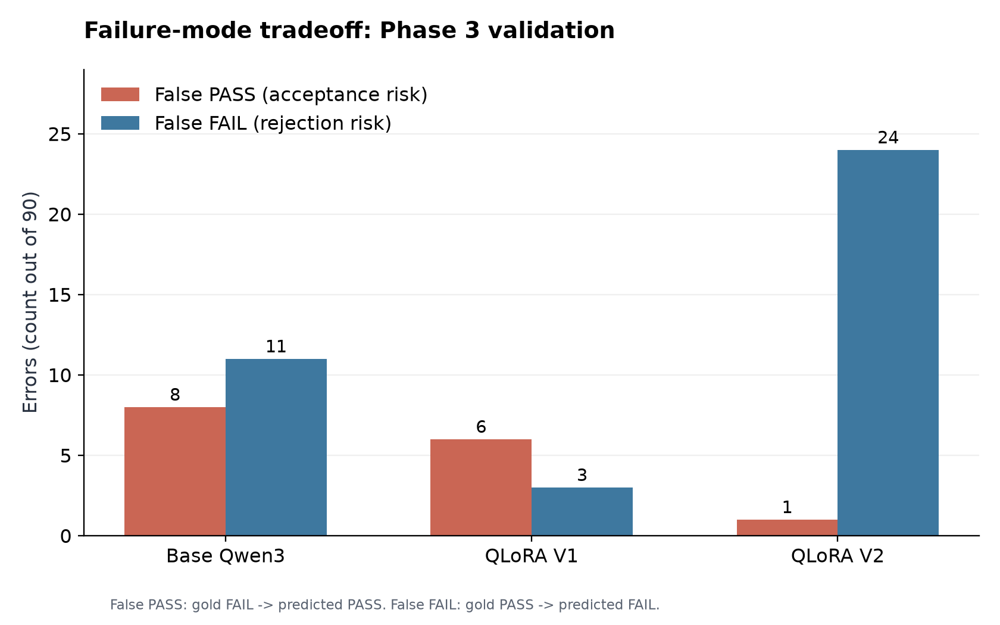
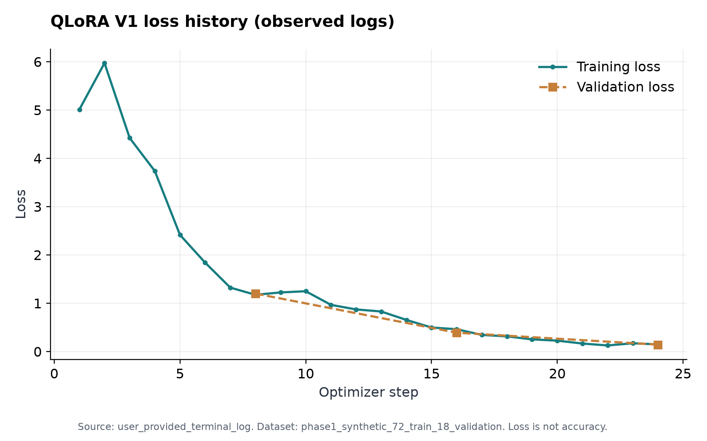

# LLM-Based Manufacturing Engineering Copilot for Design, Production, Quality, and Maintenance

<p align="center">
  
</p>

A local research prototype that combines a Qwen3-1.7B QLoRA experiment with
deterministic engineering calculations and source-cited document retrieval.

[](#verification)
[](#limitations-and-safety)

**Live research workbench:**
[manufacturing-engineering-copilot.vercel.app](https://manufacturing-engineering-copilot.vercel.app/)

The responsive workbench uses the MFG Copilot visual identity and provides one
consistent interface for natural-language routing, engineering calculators,
draft documentation, and source-grounded evidence search.

For the complete submission-ready description, results, architecture, and
future-work plan, see the **[Detailed Project Report](PROJECT_REPORT.md)**.

The hosted version runs the deterministic CPU tools and searches only the
clearly labelled fictional demonstration corpus. It does not load model weights
or provide autonomous manufacturing approval.

## Project brief

**Description:** A domain-specific LLM assistant providing intelligent support
for engineering design, process planning, production, quality assurance,
maintenance, and technical documentation.

The implemented architecture is hybrid. A natural-language assistant selects
one of seven bounded capabilities, extracts only explicitly supplied values,
and asks for missing inputs. Tested Python functions perform numerical work;
retrieval returns line-referenced excerpts; the local Qwen3-1.7B LoRA adapter
is trained for tool routing. This division makes the prototype more reliable
and auditable than asking a language model to perform engineering arithmetic.

The project covers six bounded manufacturing workflows. Numerical outputs come
from deterministic Python functions, not model-generated arithmetic. Requests
with missing inputs or unavailable documents are rejected rather than filled in
with guesses. The fine-tuned adapters are optional and cannot override computed
inspection decisions.

> **Research-only, not for product release, autonomous machining, ISO compliance
> certification, equipment operation or worker-safety decisions.**

## Architecture

```text
Operator -> natural-language assistant or direct workspace
           |-- conservative intent router (local LoRA or hosted rule router)
           |-- design fit/clearance checks (Decimal)
           |-- ideal turning process estimates
           |-- production OEE calculations
           |-- dimensional QA inclusive-limit checks (Decimal)
           |-- retrospective maintenance MTBF/MTTR
           |-- DRAFT inspection record generator
           |-- extractive RAG (approved-labelled .md/.txt, SHA-256 + line refs)
                  \-- optional Qwen3/LoRA routing/ranking
                       [not permitted to alter calculations or invent standards]
```

The project contains one narrow SLM task with two QLoRA experiments (V1 and
V2), not six domain-specific models. The six workflows are mostly deterministic
software tools. Phase 4's `demo` documents are intentionally fictional; real
approved materials are not shipped.

## Current status

| Part | Status | Practical meaning |
|---|---|---|
| Deterministic calculators | Tested research prototype | Arithmetic and refusal paths pass the included regression suite |
| Natural-language assistant | Working hosted prototype | Routes explicit requests, extracts labelled values, and asks for missing inputs |
| QLoRA tool router | Improved local experiment | Clean V5: 100% synthetic validation, 99.05% once-only synthetic test, 91.43% tuned manual development challenge |
| Browser and CLI workbench | Working research prototype | Public CPU demo on Vercel; local mode remains available |
| Document retrieval | Working on the fictional test corpus | Real retrieval quality has not been measured |
| QLoRA adapters | Experimental | Best once-only frozen manual evaluation: 44/49 (89.80%); adapters are not reliable enough to make engineering decisions |
| Held-out synthetic model test | Complete for V2 | 79/120 correct, but severe PASS-class failure prevents autonomous use |
| Real-data research pipeline | Implemented, awaiting records | Enforces permission, ethics status, de-identification, dual review, provenance, group splits, and metrics |
| Independent industrial validation | Not complete | No authorized plant dataset has been supplied; readiness fails closed |
| Database and audit trail | Research staging implemented | Phase 7 can ingest validated private records into local SQLite; the hosted app remains stateless |

`Qwen3-1.7B` is an LLM architecture, but this project calls the adapted model an
**SLM** because it is small relative to current general-purpose LLMs and is used
for one narrow experimental task. The label does not change its validation
requirements.

## Quick start

Python 3.12 is recommended. The CPU-only workbench uses the standard library and
does not require CUDA, model weights or Unsloth.

```powershell
py -3.12 -m venv .venv
.\.venv\Scripts\python.exe -m unittest discover -s tests -v
.\.venv\Scripts\python.exe -m phase5.web_app
```

Open **http://127.0.0.1:8765/**. The server binds only to loopback and refuses
untrusted `Host` headers. It is a single-user demonstration, not a public
application. To use the offline CLI:

```powershell
.\.venv\Scripts\python.exe -m phase5.cli
```

For **numerical QA**, try:

```text
quality nominal=20.00 measured=20.03 tolerance=0.05 unit=mm
quality nominal=20.00 measured=20.09 tolerance=0.05 unit=mm
```

Expected results for that single dimension: `PASS` and `FAIL`. For model
training and evaluation, see the phase-specific guides listed under
[Project documentation](#project-documentation).

## Six supported engineering slices

| Domain | Implemented calculation or workflow | Not claimed |
|---|---|---|
| Design | One-dimensional worst-case fit classification | Full CAD / ISO fit tables / FEA |
| Process planning | Ideal single-pass turning RPM, feed, cutting time | Machine-ready NC parameters |
| Production | Availability, performance, quality, OEE | Automated MES optimization |
| Quality | Inclusive bilateral/asymmetric dimensional tolerances | Part or batch release |
| Maintenance | Historical MTBF, MTTR, observed availability | Predictive RUL or automated maintenance |
| Documentation | Traceable inspection-record draft | Legally approved or digitally signed record |

Phase 4 retrieves exact approved-labelled `.md` and `.txt` paragraphs,
with SHA-256 integrity checks and line citations. Human approval metadata
is provided by the operator, not cryptographically authenticated.

## Algorithms and implementation

### Dimensional tolerance decision

`src/tolerance_engine.py` converts decimal strings directly to Python
`Decimal`, avoiding binary floating-point rounding in limit decisions. For a
symmetric tolerance `t`:

```text
lower limit = nominal - t
upper limit = nominal + t
PASS if lower limit <= measured <= upper limit; otherwise FAIL
```

Asymmetric signed lower and upper deviations are also supported. Boundaries are
inclusive. Missing values, non-finite numbers, negative symmetric tolerances,
mixed tolerance forms and unsupported units return `INSUFFICIENT_DATA`. This is
one scalar interval check; it does not include uncertainty, calibration, GD&T,
sampling plans or whole-part acceptance.

### Strict hybrid parsing

`src/hybrid_qa.py` accepts either a restricted `key=value` grammar or an
explicit natural-language pattern containing exactly one nominal value, one
measurement and one tolerance definition. Duplicate fields, extra measurements,
mixed units and unrecognized text are rejected. If the SLM is enabled here, its
only permitted output is one allowlisted presentation style. It never supplies
numbers, limits, decisions or actions.

### Engineering calculators

The Phase 5 calculators use validated `Decimal` operands and fixed equations:

| Workflow | Algorithm |
|---|---|
| Hole/shaft fit | `min clearance = hole_min - shaft_max`; `max clearance = hole_max - shaft_min`. Positive minimum is clearance, negative maximum is interference, otherwise transition. |
| Turning estimate | `RPM = 1000 × cutting_speed / (π × diameter)`; feed rate is `RPM × feed_per_rev`; ideal cutting time is `length / feed_rate`. |
| OEE | Availability is `run/planned`; performance is `ideal_cycle × total/run`; quality is `good/total`; OEE is their product. Contradictory inputs and performance above 100% are rejected. |
| Maintenance | Observed `MTBF = operating_hours/failures`, `MTTR = repair_hours/failures`, availability is `operating/(operating+repair)`. With no failures, MTBF and MTTR are reported as undefined. |
| Inspection record | Validates identifiers and a timezone-aware timestamp, reuses the tolerance engine, and emits a `DRAFT` record with `PENDING_COMPLETION` workflow status. It does not save or sign the record. |

The turning and maintenance outputs are retrospective or idealized estimates.
They are not machine settings, predictions or safe-to-operate decisions.

### Grounded document retrieval

Phase 4 implements a small, transparent lexical retrieval pipeline:

1. Read only manifest-registered UTF-8 `.md` and `.txt` files below
   `phase4/docs`.
2. Validate document status, relative path, size, revision metadata and SHA-256
   before indexing any content.
3. Split text into paragraph chunks while retaining exact line ranges.
4. Lowercase and tokenize alphanumeric terms, remove a fixed stopword list and
   apply two small plural-normalization rules.
5. Rank paragraphs with BM25 (`k1=1.2`, `b=0.75`). A candidate must share at
   least two query terms, cover at least 30% of query terms and score at least
   `0.75`.
6. Return exact excerpts with source ID, revision, line citation and checksum,
   or abstain when nothing passes the thresholds.

Questions naming a standard require the exact standard identifier to occur in
the retrieved text. An optional Qwen/LoRA selector may reorder existing hits by
returning only `SELECT: n`; invalid model output falls back to the top lexical
hit. Retrieved text is treated as untrusted data and is never executed.

## Model-training methodology

- **Foundation:** `unsloth/Qwen3-1.7B-unsloth-bnb-4bit`.
- **Training hardware:** NVIDIA RTX 4060 Laptop GPU, 8 GB VRAM.
- **Fine-tuning:** 4-bit QLoRA, rank 8, alpha 16, supervised fine-tuning.
- **Adapted modules:** attention `q/k/v/o` projections and MLP
  `gate/up/down` projections; dropout 0 and no bias adaptation.
- **Training objective:** completion-only causal language-model loss on the
  four-line assistant response; prompt tokens are masked.
- **Optimizer and schedule:** 8-bit AdamW, linear schedule, 3% warm-up,
  weight decay 0.01 and gradient checkpointing.
- **Phase 1 dataset:** 72 train / 18 validation / 24 test synthetic cases.
- **Phase 3 V2 dataset:** 480 train / 90 validation / 120 held-out synthetic cases.
- **Phase 3 V2 configuration:** 120 steps, batch 1, gradient accumulation 4,
  learning rate 1.2e-4. V2 trains independently from the foundation model.
- **Clean tool-router dataset:** 1,050 train / 140 validation / 210 locked
  synthetic test requests, balanced across seven tools, plus 35-request
  development and 49-request second manually authored challenges.
- **Tool-router configuration:** QLoRA rank 8, alpha 16, 140 steps, batch 2,
  gradient accumulation 4, learning rate 1e-4 and completion-only loss.
- **Checkpoints:** stored locally, not bundled or committed.

Run model training locally if necessary (`.venv` must have GPU PyTorch + Unsloth):

```powershell
.\.venv\Scripts\python.exe -m phase3.validate_data
.\.venv\Scripts\python.exe -m phase3.train_v2 --smoke
.\.venv\Scripts\python.exe -m phase3.train_v2
.\.venv\Scripts\python.exe -m phase3.generate_router_data
.\.venv\Scripts\python.exe -m phase3.validate_router_data
.\.venv\Scripts\python.exe -m phase3.train_router --max-steps 140 --output-dir models/router_qlora_v5_unique
.\.venv\Scripts\python.exe -m phase3.evaluate_router --adapter models/router_qlora_v5_unique/adapter --split validation --tag router_v5_unique
```

The V2 training script refuses to overwrite an existing adapter. Preserve local
checkpoints before starting another run; model weights remain outside the source
release.

### Tool-routing results

| Evaluation | Correct | Accuracy | Parse rate | Lowest class recall |
|---|---:|---:|---:|---:|
| Validation | 131/140 | **93.57%** | 100% | 90% |
| Locked synthetic test | 210/210 | **100%** | 100% | 100% |
| Manual post-training challenge | 30/35 | **85.71%** | 97.14% | 40% (knowledge) |

The locked synthetic test was run once after selecting the adapter on
validation. Its perfect result means the bounded synthetic intent task was
learned; it is not industrial accuracy. The manually authored challenge is a
more difficult warning: evidence-search routing generalized poorly. All three
results and hashes are published in
[`phase6/evidence/router_v2_evaluation.json`](phase6/evidence/router_v2_evaluation.json).

The clean V5 candidate removed duplicate prompts, expanded training and added
an explicit router-data validator. It achieved 140/140 on unique synthetic
validation and 208/210 (99.05%) on the once-only synthetic test. It scored
32/35 (91.43%) on the original manual challenge using the current descriptive
router prompt. That challenge had already influenced development, so it is a
development benchmark—not an untouched test. A broader-language V3 candidate
scored 44/49 (89.80%) on a second manually written set frozen before its first
evaluation. See
[`phase6/evidence/router_v5_evaluation.json`](phase6/evidence/router_v5_evaluation.json).

The dataset validator reports 1,484/1,484 structurally valid records, balanced
labels, matching manifest hashes and zero normalized user-prompt duplicates
across all five files. This is a 100% data-integrity result, not a claim that
the records are independently engineer-approved or that the model is 100%
accurate on new manufacturing language.

## Observed synthetic-validation outcomes

Same Phase 3 synthetic validation split, `n = 90`:

| Model | Correct | Accuracy | PASS recall | FAIL recall | Missing-data recall | False PASS | False FAIL |
|---|---:|---:|---:|---:|---:|---:|---:|
| Base Qwen3 | 40/90 | 44.44% | 43.33% | 56.67% | 33.33% | 8 | 11 |
| QLoRA V1 | 38/90 | 42.22% | 40.00% | 23.33% | 63.33% | 6 | 3 |
| QLoRA V2 | 59/90 | **65.56%** | **16.67%** | 96.67% | 83.33% | **1** | 24 |

*Source: console comparison supplied by the operator (2026-11-13); local
model-result JSON is not included in GitHub. These are synthetic validation
results, not industrial accuracy.* V2 improves accuracy on this sample but
exhibits 24 false rejections. We therefore **do not** delegate numerical
inspection decisions to the standalone SLM.

Final once-only Phase 3 synthetic test result, `n = 120`:

| Model | Correct | Accuracy | PASS recall | FAIL recall | Missing-data recall | False PASS | False FAIL |
|---|---:|---:|---:|---:|---:|---:|---:|
| QLoRA V2 | 79/120 | **65.83%** | **10.00%** | 87.50% | 100.00% | 3 | 22 |

The 95% Wilson interval for test accuracy is 56.97%–73.71%. The close match
between validation accuracy (65.56%) and test accuracy (65.83%) shows that the
reported synthetic result reproduces on the held-out split. It does **not** make
the model safe: only 4 of 40 conforming test cases were classified correctly.
The public summary is stored in `phase6/evidence/v2_final_test.json`; raw local
responses remain gitignored.

### Validation assessment

The evaluation code has several good controls: it checks dataset fingerprints,
prevents cross-split duplicate IDs and identical inputs, recomputes every gold
label with the deterministic engine, uses greedy decoding, records raw
predictions, reports per-class accuracy and error modes, and prevents accidental
test-set evaluation without an explicit flag.

That is a sound **synthetic experiment pipeline**, but it is not industrial
model validation:

- V2 has now been evaluated once on the locked 120-case Phase 3 test split.
  This closes the internal synthetic test, not external validation.
- All examples are generated from the same rules that later verify their labels.
  Numeric ranges and wording differ by split, but the data still has narrow,
  repeated templates and no real measurement noise or industrial context.
- No examples have independent engineer-reviewed ground truth. There is no
  external dataset, blind review, inter-rater agreement or plant trial.
- V2 is heavily biased toward `FAIL`: it correctly identifies 29/30 FAIL cases
  but only 5/30 PASS cases. Its higher overall accuracy therefore hides poor
  acceptance-class performance.
- Only one training seed and one main hyperparameter run are reported. There is
  no multi-seed variance, ablation study, calibration analysis or paired
  significance result intended for a final paper claim.
- The current metric treats all three labels equally. A manufacturing study
  should predefine the relative cost of false acceptance, false rejection and
  unjustified decisions before selecting a model.

Accordingly, synthetic V2 testing is complete, but real model validation is
**not done**. The correct present architecture is the one already used here:
deterministic tools own numerical outcomes, while the model remains optional
and tightly constrained.

Generated figures:






Regenerate with:

```powershell
.\.venv\Scripts\python.exe -m pip install -r requirements-phase6.txt
.\.venv\Scripts\python.exe -m phase6.plot_results
```

The script uses local `results/phase3/*.json` when all corresponding actual
model-evaluation artifacts exist, checks dataset hashes and split identity, and
uses labelled recorded scores only as a fallback. It also generates a
V2 training-loss figure if the original V2 trainer-state log exists locally.
See [`docs/PAPER_FIGURE_NOTES.md`](docs/PAPER_FIGURE_NOTES.md) for captions and
limits. Phase 1 small-data metrics are deliberately excluded from the Phase 3
side-by-side chart because the data distributions differ.

## Verification

```powershell
.\.venv\Scripts\python.exe -m phase6.reproduce
.\.venv\Scripts\python.exe -m phase6.release_checks
```

The CPU suite includes 136 unit tests, Phase 3 data provenance and split hashes,
Phase 4 fictional retrieval regressions, Phase 5 arithmetic checks and an
expanded **529-case** tolerance-boundary grid. GitHub Actions runs CPU checks
without downloading model weights or installing GPU packages. These tests
establish **software behavior under included cases**, not shop-floor fitness.

## Data, storage and runtime

The hosted prototype is stateless. Phase 7 provides a local SQLite research
store only after real records pass authorization, provenance, de-identification,
annotation, and integrity validation:

| Data | Format and location | Published? |
|---|---|---|
| Synthetic training/validation/test cases | JSONL under `data/` and `phase3/data/` | Yes |
| Dataset counts and fingerprints | JSON manifests with SHA-256 | Yes |
| Retrieval source registry | `phase4/knowledge_manifest.json` | Yes |
| Fictional retrieval documents | Markdown under `phase4/docs/` | Yes |
| Real local documents | `phase4/docs/local/` | No, ignored by Git |
| Authorized industrial research records | `phase7/private_data/` | No, ignored by Git |
| Grouped splits and SQLite research store | `phase7/output/` | No, ignored by Git |
| Real-data schema, validator and aggregate readiness report | `phase7/` | Yes |
| QLoRA adapters and checkpoints | Hugging Face/PEFT files under `models/` | No, ignored by Git |
| Evaluation predictions and reports | JSON/JSONL under `results/` | No, ignored by Git |
| Paper figure inputs and provenance | JSON/CSV under `phase6/evidence/` and `paper_figures/` | Selected summaries only |

The web UI uses Python's standard-library `HTTPServer`, binds to
`127.0.0.1`, accepts bounded JSON requests and returns calculated JSON. It has
no accounts, sessions, uploads, telemetry, background jobs or external API.
Generated inspection records disappear after the response unless the operator
saves them manually. A production design would need a real database schema,
migrations, immutable audit events, role-based access, authenticated approvals,
record versioning, retention rules, backup/restore and encryption policy.

## What should be improved next

Priority order for the next development session:

1. Keep the completed 120-case test split locked. Do not tune against its
   result or inspect it repeatedly during model development.
2. Build a permission-cleared, independently engineer-reviewed evaluation set
   that represents real wording, units, boundary cases, missing evidence and
   measurement uncertainty. Keep it outside training.
3. Diagnose V2's rejection bias from the saved predictions. Add confusion
   matrices, macro-F1, balanced accuracy, class precision/recall and explicit
   cost-weighted safety metrics.
4. Run multiple seeds and controlled ablations before choosing new data,
   training duration, rank or learning rate. Preserve every config and dataset
   hash.
5. Separate model-selection validation from the final test set and introduce a
   second external challenge set. Avoid repeated manual inspection of final-test
   errors during development.
6. Evaluate retrieval on a labelled query/relevance set using recall@k, MRR,
   abstention precision and citation correctness. The current 16-case demo
   regression checks behavior, not retrieval quality.
7. Decide whether persistence is actually required. If it is, design the audit
   and approval model before adding a database; storing draft records without
   provenance and access control would create misleading traceability.
8. Pin dependency versions and add a repeatable GPU environment/container plus
   automated adapter/evaluation metadata capture.
9. Only after the above, consider expanding beyond scalar dimensional QA into
   GD&T, uncertainty, calibration state or other manufacturing domains.

The attempted longer V3 report training and V4 label-only training did not beat
V2 on validation, so neither was promoted. More epochs on the same synthetic
distribution are not considered a valid improvement.

## Project map

```text
src/             Phase 1 QLoRA and Phase 2 deterministic + hybrid QA
phase3/          Expanded synthetic QA dataset, V2 training, model comparison
phase4/          Hash-verified, line-cited extractive RAG
phase5/          Six-domain calculators, local CLI and browser dashboard
phase6/          Reproducibility checks, audit, metric import and paper figures
phase7/          Authorized real-data validation, grouped splits, SQLite staging and evaluation
tests/           CPU-only regression suites
paper_figures/   Observed synthetic metrics and loss charts (PNG/SVG + source CSV)
configs/         Training configurations
models/          Local adapters and checkpoints (gitignored)
results/         Operator-local benchmarks and predictions (gitignored)
```

## Limitations and safety

- No real manufacturing field evaluation or independent engineer-reviewed data
  has been supplied for this repository release.
- No autonomous tool operation, motion control, product release or compliance
  decision is implemented.
- Calculations require correctly entered units and valid measurements;
  source calibration, uncertainty budgets and other acceptance criteria are
  outside scope.
- RAG's default published documents are fictional examples. Third-party
  standards and confidential work instructions are not redistributed.
- The local HTTP mode has no user authentication, database, tamper-proof audit
  log, or multiuser controls and must remain loopback-only. The public Vercel
  demo is stateless, uses a fictional corpus, excludes model weights, and cannot
  store or approve engineering records.
  See `MODEL_CARD.md` and `docs/PAPER_FIGURE_NOTES.md` before citing metrics.

## Project documentation

- [Phase 3: expanded dataset and V2 training](PHASE3_README.md)
- [Phase 4: local grounded retrieval](PHASE4_README.md)
- [Phase 5: six-domain workbench](PHASE5_README.md)
- [Phase 6: reproducibility and figures](PHASE6_README.md)
- [Phase 7: real manufacturing data protocol](phase7/REAL_DATA_PROTOCOL.md)
- [IEEE submission readiness](IEEE_READINESS.md)
- [Model card](MODEL_CARD.md)
- [Submission and demonstration guide](SUBMISSION_GUIDE.md)
- [Release notes](RELEASE_NOTES.md)

## Repository contents and reuse

Code is released under the MIT License (see `LICENSE`). Model weights and
individual foundation-model licensing remain governed by their own terms. No
private documents, adapters, or evaluation prediction logs are in the source
archive. Configuration and dataset generation are included for reproducibility.
